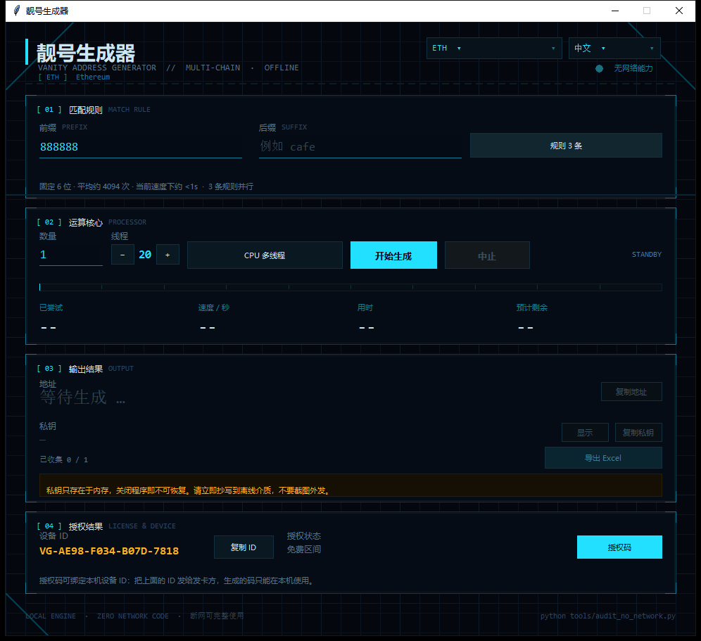
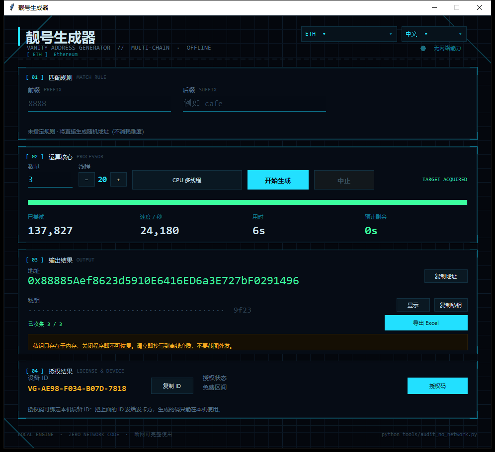

# 靓号生成器 · 离线多链地址生成器


> 本地暴力生成十六进制靓号地址。**私钥不出本机、软件无联网能力、核心代码开源可审计。**

这是客户端的开源部分：地址生成、GPU 内核、靓号匹配、授权码离线验签、界面与导出。签发工具与售卖服务端属于私有部分，不在本仓库。



## 它是什么

- 一个**离线**的多链靓号地址生成工具：在本机用 CPU 多线程或 GPU（OpenCL）暴力搜索符合规则的地址（前缀 / 后缀）。
- 私钥只在内存里生成，程序没有任何联网代码，断网也能完整运行。
- 核心生成算法开源，任何人可以自己审代码、自己跑审计脚本验证。

**它不是什么**：不托管私钥、不做「仿冒某个已有地址」的定制、不承诺绝对安全、不承诺靓号升值。

## 安全承诺（怎么验证）

| 承诺 | 怎么验证 |
| --- | --- |
| **不联网** | 仓库里没有任何网络模块。跑 `python tools/audit_no_network.py`，它扫描全部源码并逐项列出禁用模块（socket / ssl / http / urllib / requests / webbrowser …），输出「通过」才说明代码层面无联网能力 |
| **私钥不落盘** | 生成过程中的私钥只存在于内存，不写文件、不进日志；结果由你手动保存，唯一落盘是你主动点「导出 Excel」 |
| **不上传** | 上面两条成立时，没有任何通道可以把私钥送出去。你也可以断网运行，或用防火墙出站规则拦住它，功能完整 |
| **授权码可离线验** | Ed25519 公钥内置在 `app/_public_key.py`，纯标准库实现验签（`app/ed25519.py`），断网也能验，无需请求服务器 |
| **无第三方依赖** | Python 只用标准库（`ctypes` 调系统 OpenCL.dll）；Node 只用内置 `crypto` |

## 功能

- **8 条链**：ETH / BSC / Polygon / Arbitrum / Base（EVM）、BTC / DOGE / TRON（Base58Check）
- **CPU 多线程** 与 **GPU（OpenCL）** 两条生成路径，GPU 默认关闭，由用户手动开启；8 条链 GPU 全覆盖
- **前缀 / 后缀匹配**：固定位数难度 = 16^n（EVM）/ 58^n（Base58），界面实时给进度、速度与预计时间
- **多规则并行**：最多 32 条规则同时匹配，命中任意一条即产出（多规则属授权功能）
- **批量生成**：一次指定条数，结果表可导出 `.xlsx`（序号 / 链 / 地址 / 私钥 / 尝试次数 / 耗时 / 命中规则 / 时间）
- **随机模式**：不填规则直接生成随机地址，不消耗难度、不扣额度
- **中英切换**、链切换、规则与设置记忆（`data/state.json`）
- **开跑前确认框**：列出规则 / 运算模式 / 链 / 数量 / 本次扣几次，确认后才扣额度
- **纯 tkinter.Canvas 自绘界面**，无图片资源、无第三方 UI 库



## 快速开始

需要：**Python 3.9+（带 tkinter）**、**Node.js 18+**。

```bat
run.bat
```

`run.bat` 会自动找 `pythonw.exe` 与 `node.exe`（先查 `runtime\node.exe`，再查 PATH 与默认安装目录）。

### 从源码运行

```bat
:: 自检（不开界面，直接生成 1 条地址验证引擎链路）
python app\main.py --selftest

:: 零联网审计（必须退出码 0）
python tools\audit_no_network.py

:: 启动界面
python app\main.py
```

### 打包成 exe（PyInstaller）

仓库自带 `vanity.spec`，用 PyInstaller 打成 onedir 包，`node.exe`、`gpu/*.cl`、`engine/*.js` 一并打进包内：

```bat
pyinstaller vanity.spec
```

## 目录

```
app/       客户端（tkinter 界面、授权验签、设备 ID、Excel 导出、纯标准库二维码）
engine/    CPU 生成引擎（Node.js，多线程 worker + secp256k1 + keccak）
gpu/       GPU 内核（OpenCL：secp256k1 / keccak / sha256 / ripemd160 / base58）
tools/     audit_no_network.py（零联网审计）、qr_selftest.py（二维码自检）
tests/     手工验证脚本（地址向量、GPU 对照、UI 布局、授权验签等）
docs/      界面预览截图
```

## 授权怎么算

- 固定字符数（前缀 + 后缀）**≤ 7 位：免费不限量**
- 8 位起：每生成 1 条扣 1 次额度，点「开始生成」即扣，中止或没找够都不退
- **多规则并行**（第 2 条及以后的规则）：需要有效授权
- 授权码 = `base64url(payload) + "." + base64url(Ed25519 签名)`，可绑定设备 ID，离线验签

## 已知边界（如实列出）

- 本地额度账本用 HMAC 防手改，但**删掉账本文件可以恢复次数**——这是纯本地软件的固有边界，防普通用户，防不住专业逆向
- 设备 ID 由本机信息派生，可以被改写；绑定只能挡普通用户
- 随机数来自系统 CSPRNG，本仓库不声称密码学审计
- GPU 目前只适配 Windows（`ctypes` 加载 `OpenCL.dll`），macOS / Linux 未适配
- 32 条规则并行时每条候选都要逐条比对，规则越多吞吐越低

## 许可

客户端代码以 MIT 许可发布；签发工具、售卖服务端与运营配置不在此仓库、不随本仓库分发。
