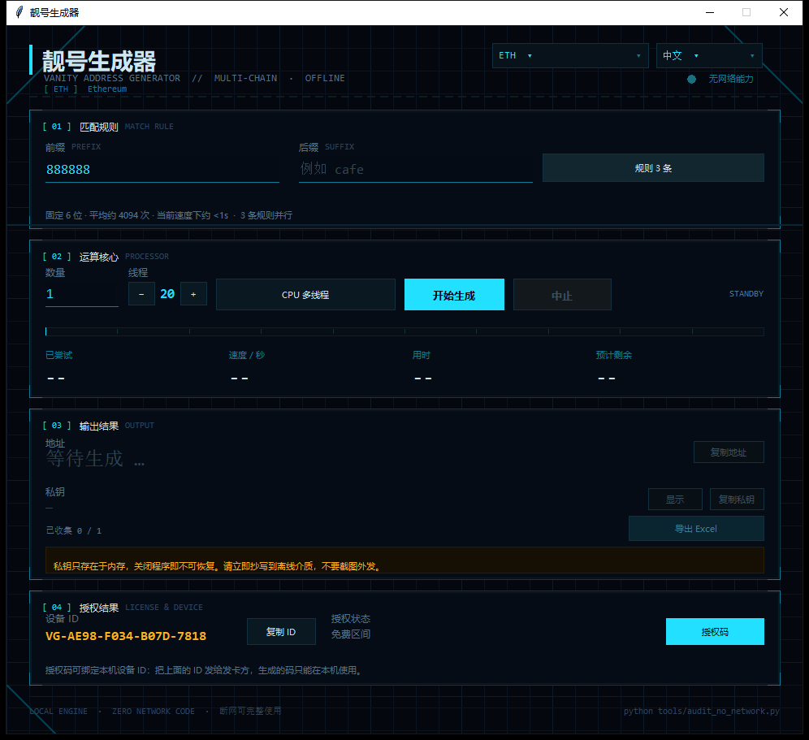
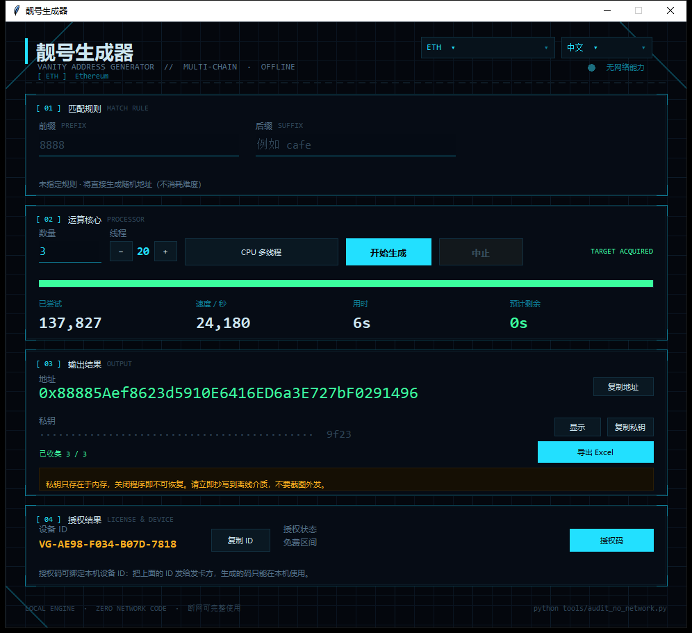

# Vanity Address Generator · Offline Multi-Chain


> Brute-force hex vanity addresses locally. **Your private key never leaves this machine, the app has zero networking code, and the core code is open for audit.**

This is the open-source client side: address generation, GPU kernel, pattern matching, offline license verification, UI and export. The issuing tools and the store backend are private and not included.



## What it is

- An **offline** multi-chain vanity address generator: searches locally with CPU threads or GPU (OpenCL) for addresses matching a prefix / suffix rule.
- Private keys are generated in memory only; the program contains no networking code and works fully offline.
- The core algorithms are open source — anyone can read the code and run the audit scripts themselves.

**What it is not**: it does not custody private keys, does not forge an existing address, does not claim absolute security, and does not promise any value appreciation.

## Security promises (how to verify)

| Promise | How to verify |
| --- | --- |
| **No network** | No networking module anywhere in the repo. Run `python tools/audit_no_network.py`; it scans every source file against a blocklist (socket / ssl / http / urllib / requests / webbrowser …) and prints "pass" only when no networking import exists |
| **Key never written to disk** | The private key lives in memory only during generation; nothing is written to files or logs. The only file output is when you manually click "Export Excel" |
| **Nothing uploaded** | With the two points above, there is no channel to send a key out. You can unplug the network or block the app with a firewall and everything still works |
| **Offline license check** | The Ed25519 public key is built into `app/_public_key.py`; verification (`app/ed25519.py`) uses the standard library only and needs no server, even offline |
| **No third-party dependencies** | Python uses the standard library only (`ctypes` calls the system OpenCL.dll); Node uses built-in `crypto` |

## Features

- **8 chains**: ETH / BSC / Polygon / Arbitrum / Base (EVM), BTC / DOGE / TRON (Base58Check)
- **CPU multithreaded** and **GPU (OpenCL)** paths; GPU is off by default and enabled manually; all 8 chains support GPU
- **Prefix / suffix matching**: difficulty = 16^n (EVM) / 58^n (Base58); live progress, speed and ETA in the UI
- **Multi-rule parallel**: up to 32 rules matched at once, any hit produces a result (multi-rule requires a license)
- **Batch generation**: collect N results; export the table to `.xlsx` (index / chain / address / private key / attempts / elapsed / matched rule / time)
- **Random mode**: generate random addresses with no rule, no difficulty, no charge
- **Chinese / English toggle**, chain switch, rules and settings remembered (`data/state.json`)
- **Pre-run confirmation dialog**: lists rules / mode / chain / count / credits charged; nothing is deducted until you confirm
- **Pure tkinter.Canvas UI**: no image assets, no third-party UI toolkit



## Quick start

Requires **Python 3.9+ (with tkinter)** and **Node.js 18+**.

```bat
run.bat
```

`run.bat` locates `pythonw.exe` and `node.exe` (checks `runtime\node.exe`, then PATH and default install dirs).

### Run from source

```bat
:: Self-test (no UI, generates 1 address to verify the engine pipeline)
python app\main.py --selftest

:: Offline audit (must exit 0)
python tools\audit_no_network.py

:: Launch the UI
python app\main.py
```

### Build an exe (PyInstaller)

`vanity.spec` is included; PyInstaller builds an onedir package with `node.exe`, `gpu/*.cl` and `engine/*.js` bundled:

```bat
pyinstaller vanity.spec
```

## Layout

```
app/       Client (tkinter UI, license verification, device ID, Excel export, stdlib QR)
engine/    CPU engine (Node.js, threaded worker + secp256k1 + keccak)
gpu/       GPU kernel (OpenCL: secp256k1 / keccak / sha256 / ripemd160 / base58)
tools/     audit_no_network.py (offline audit), qr_selftest.py (QR self-test)
tests/     Manual verification scripts (vectors, GPU cross-check, UI layout, license)
docs/      UI screenshots
```

## License model

- Fixed characters (prefix + suffix) **≤ 7: free, unlimited**
- From 8 characters: 1 credit per generated address; credits are charged when you press Start, never refunded on abort or miss
- **Multi-rule parallel** (2nd rule and beyond): requires a valid license
- License code = `base64url(payload) + "." + base64url(Ed25519 signature)`, bound to a device ID, verified offline

## Known limits (stated honestly)

- The local credit ledger uses HMAC to resist tampering, but deleting the ledger file resets the count — an inherent limit of local-only software; it stops casual users, not reverse engineers
- Device ID is derived from local machine info and can be spoofed; binding only blocks casual users
- Randomness comes from the system CSPRNG; this repo makes no cryptographic audit claim
- GPU currently targets Windows only (`ctypes` loads `OpenCL.dll`); macOS / Linux are not adapted
- With 32 parallel rules every candidate is checked against all rules; more rules = lower throughput

## License

Client code is released under MIT; the issuing tools, store backend and operational config are not part of this repository.
